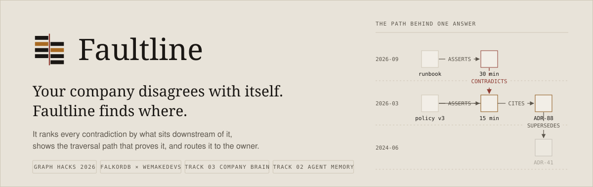
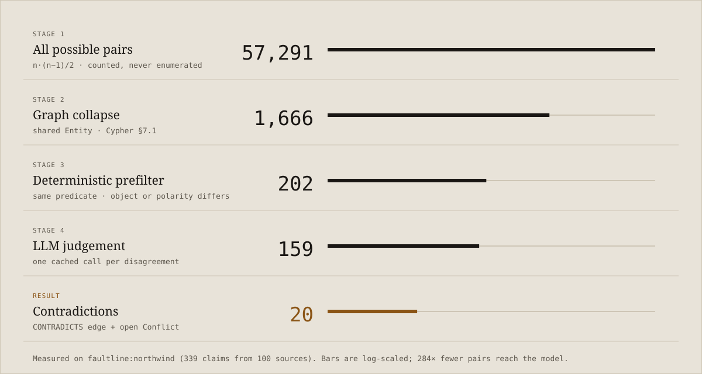
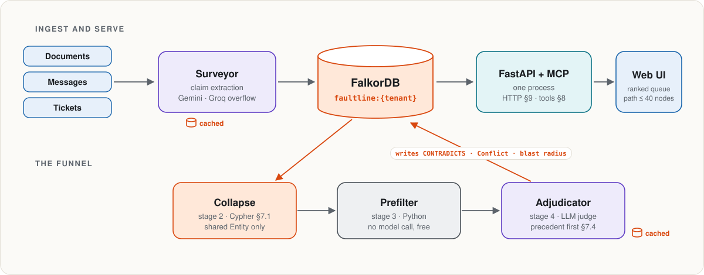
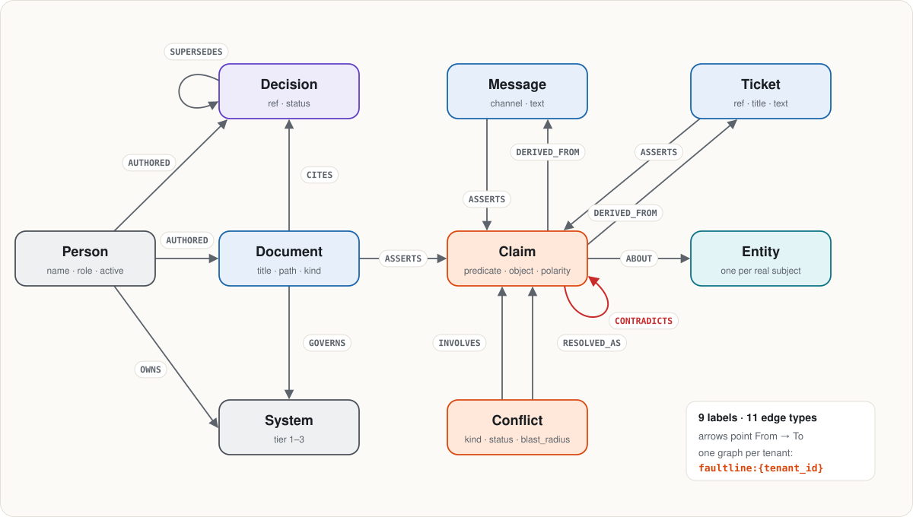
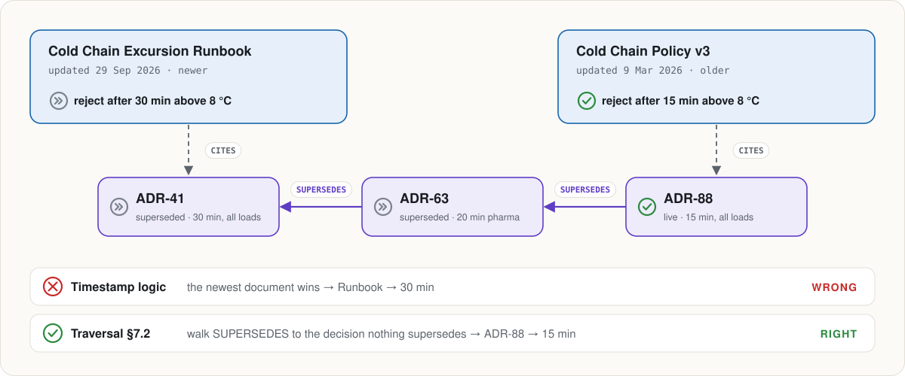

<picture>
  <source media="(prefers-color-scheme: dark)" srcset=".github/readme/hero-dark.svg">
  
</picture>

<picture>
  <source media="(prefers-color-scheme: dark)" srcset=".github/readme/stack-dark.svg">
  
</picture>

Every organisation's runbooks, wikis, specs and chat history disagree with each other somewhere. A runbook still says 30 minutes after the policy moved to 15. A README cites a decision that was superseded two ADRs ago. Nobody notices until an incident.

**Faultline finds those contradictions on its own.** It's not a chatbot, and there's no "ask your docs" box. You open it and see a ranked queue of conflicts, each with the evidence, the traversal path that proves it, what sits downstream of it, and who owns the fix.

Comparing every claim with every other claim is O(n²): about 1,800 claims means about 1.7 million comparisons. Faultline only compares claims that share a subject node in the graph. **Without FalkorDB the product isn't just slower, it's impossible.** Everything below serves that one property.

<table>
<tr>
<td><a href="#the-funnel">The funnel</a></td>
<td><a href="#how-it-works">How it works</a></td>
<td><a href="#graph-model">Graph model</a></td>
<td><a href="#the-queries">The queries</a></td>
<td><a href="#blast-radius">Blast radius</a></td>
</tr>
<tr>
<td><a href="#run-it-locally">Run it locally</a></td>
<td><a href="#free-api-keys">Free API keys</a></td>
<td><a href="#repo-layout">Repo layout</a></td>
<td><a href="#status">Status</a></td>
<td><a href="#rules">Rules</a></td>
</tr>
</table>

---

##  The funnel

<picture>
  <source media="(prefers-color-scheme: dark)" srcset=".github/readme/funnel-dark.svg">
  
</picture>

Two of the four stages cost nothing. Only stage 4 calls a model, and every call it makes is cached to disk.

| Stage | Mechanism | Cost | Measured* |
| --- | --- | --- | ---: |
| 1. All possible pairs | `n·(n−1)/2`, counted, never enumerated | none | 780 |
| 2. **Graph collapse** | claims sharing an `Entity` node, [Cypher §7.1](#71-candidate-collapse) | one query | 56 |
| 3. **Deterministic prefilter** | same `predicate` AND (different `object` OR opposite `polarity`) | pure Python | 12 |
| 4. LLM judgement | Adjudicator, with precedent checked first | cached calls | ≤ 12 |

<sub>*Measured on the 40-claim, 12-entity synthetic graph by `python -m graph.collapse_demo`. Each stage-2 and stage-3 pair is checked against an independent brute-force oracle at two confidence floors. Stage 4 is an upper bound until the Adjudicator lands. Real-corpus numbers replace these once ingest runs; we never tune data to hit a target.</sub>

---

##  How it works

<picture>
  <source media="(prefers-color-scheme: dark)" srcset=".github/readme/architecture-dark.svg">
  
</picture>

1. **Surveyor** extracts constrained claims from documents, messages and tickets. Each claim has a subject, a predicate, an object, a polarity, a confidence, and an `evidence_span` that must be a literal substring of its source, or the claim is dropped. Claims below 0.65 confidence never enter the graph.
2. **Entity resolution** maps every alias to exactly one `Entity` node. There are no `SAME_AS` edges, so "claims about the same thing" is an exact shared-node match rather than a variable-length walk.
3. **Collapse → prefilter → Adjudicator** narrows the candidate pairs (above). The Adjudicator checks precedent before judging, and writes a `CONTRADICTS` edge that records the judging model in `method`.
4. **Ranking** scores each conflict by its [blast radius](#blast-radius): which systems, documents and decisions sit downstream of it.
5. **Serving.** FastAPI and FastMCP run in one process. The UI never renders the whole graph, only the traversal path behind one conflict, capped at 40 nodes.

---

##  Graph model

<picture>
  <source media="(prefers-color-scheme: dark)" srcset=".github/readme/graph-model-dark.svg">
  
</picture>

<details>
<summary><b>Node labels and properties</b></summary>

| Label | Properties |
| --- | --- |
| `Claim` | `id` (uuid), `text`, `polarity` (`affirm` \| `deny`), `subject_ref`, `predicate` (snake_case), `object`, `evidence_span`, `confidence` (0–1), `extracted_at` |
| `Entity` | `id` (slug), `name`, `type` (`system` \| `policy` \| `metric` \| `process` \| `artifact`) |
| `Document` | `id`, `title`, `path`, `kind` (`runbook` \| `wiki` \| `spec` \| `readme`), `updated_at` |
| `Decision` | `id`, `ref` (e.g. `ADR-88`), `title`, `status` (`accepted` \| `superseded` \| `rejected`), `decided_at` |
| `Person` | `id`, `name`, `role`, `active` |
| `System` | `id`, `name`, `tier` (1–3, 1 = most critical) |
| `Ticket` | `id`, `ref`, `title`, `text`, `state`, `closed_at` |
| `Message` | `id`, `channel`, `text`, `sent_at` |
| `Conflict` | `id`, `blast_radius`, `status` (`open` \| `resolved` \| `dismissed`), `kind` (`direct` \| `superseded` \| `undocumented`), `found_at` |

</details>

<details>
<summary><b>Edge types</b></summary>

| Edge | From → To | Properties |
| --- | --- | --- |
| `ASSERTS` | Document \| Message \| Ticket → Claim | |
| `ABOUT` | Claim → Entity | |
| `CONTRADICTS` | Claim → Claim | `confidence`, `evidence_span`, `method` (the judging model) |
| `SUPERSEDES` | Decision → Decision | newer → older |
| `CITES` | Document → Decision | |
| `GOVERNS` | Document → System | |
| `AUTHORED` | Person → Document \| Decision | |
| `OWNS` | Person → System | |
| `DERIVED_FROM` | Claim → Message \| Ticket | |
| `INVOLVES` | Conflict → Claim | `side` (`a` \| `b`) |
| `RESOLVED_AS` | Conflict → Claim | `rationale`, `resolved_at`, `resolved_by` |

</details>

**Multi-tenancy uses FalkorDB's multigraph feature.** Each tenant gets its own graph, `faultline:{tenant_id}`, and no node carries a `tenant` property. The demo tenant is `faultline:northwind`; the test graph lives in `faultline:synthetic`, so tests never touch demo data.

Uniqueness on `id` is enforced for `Claim`, `Entity`, `Document`, `Decision`, `Person`, `System` and `Conflict` through FalkorDB's native `GRAPH.CONSTRAINT CREATE`. FalkorDB rejects Neo4j's `CREATE CONSTRAINT … ASSERT` syntax. [graph/schema.py](graph/schema.py) is idempotent and waits until every constraint reports `OPERATIONAL`.

---

##  The queries

Raw Cypher, no ORM. These are in [graph/queries.py](graph/queries.py) and return plain dicts.

### 7.1 Candidate collapse

```cypher
// Every pair of claims sharing a subject, excluding pairs already judged.
MATCH (a:Claim)-[:ABOUT]->(e:Entity)<-[:ABOUT]-(b:Claim)
WHERE a.id < b.id
  AND a.confidence >= $floor
  AND b.confidence >= $floor
  AND NOT (a)-[:CONTRADICTS]-(b)
  AND NOT (a)<-[:INVOLVES]-(:Conflict)-[:INVOLVES]->(b)
RETURN a.id AS a_id, a.text AS a_text, a.predicate AS a_pred, a.object AS a_obj,
       b.id AS b_id, b.text AS b_text, b.predicate AS b_pred, b.object AS b_obj,
       e.id AS entity_id, e.name AS entity
ORDER BY e.id
```

Three things about this query, each verified against a running FalkorDB rather than assumed:

1. **`EXISTS(pattern)` is rejected.** FalkorDB refuses traversal patterns as arguments to `exists()`, so the query uses bare pattern predicates.
2. **`a.id < b.id` is load-bearing.** The shared-entity pattern binds `a` and `b` to the *same* claim, 40 times on the synthetic graph. Without the comparison, the result also contains self-pairs and reversed duplicates.
3. **The exclusion is "a Conflict involving both claims".** It is not "either claim appears in some Conflict", which would silently hide unjudged pairs whose sides belong to two different conflicts. The demo checks both cases.

### 7.2 Current decision: traversal, not timestamp

<picture>
  <source media="(prefers-color-scheme: dark)" srcset=".github/readme/supersedes-dark.svg">
  
</picture>

```cypher
// From any decision, walk SUPERSEDES backwards to the one nothing supersedes.
MATCH (start:Decision {id: $decision_id})
OPTIONAL MATCH (live:Decision)-[:SUPERSEDES*1..10]->(start)
WHERE NOT (:Decision)-[:SUPERSEDES]->(live)
RETURN coalesce(live, start) AS current,
       coalesce(length(shortestPath((live)-[:SUPERSEDES*]->(start))), 0) AS chain_depth
```

A document with a newer `updated_at` can still be wrong. Timestamp logic gets this case backwards; graph traversal gets it right. `chain_depth` is `0` when the decision is already current.

### 7.4 Precedent

Before judging a pair, the Adjudicator asks whether a conflict about the same entity has already been settled. If it has and the claims are unchanged, nothing is re-flagged; if the text changed, the conflict escalates instead of duplicating. This is what carries our Track 02 (agent memory) entry.

```cypher
MATCH (k:Conflict)-[:INVOLVES]->(a:Claim)-[:ABOUT]->(e:Entity)
MATCH (k)-[:RESOLVED_AS]->(winner:Claim)
WHERE e.id = $entity_id AND k.status = 'resolved'
RETURN DISTINCT k.id AS conflict_id, winner.id AS winner_id,
       winner.text AS winner_text, k.found_at AS settled_at
ORDER BY k.found_at DESC
LIMIT 5
```

### 7.5 Traversal path for the UI

The subgraph behind one conflict: its claims, the documents that assert them, the systems those documents govern, the decisions they cite with their SUPERSEDES chain, and any message or ticket each claim was derived from. `LIMIT 40`. The full graph is never sent to the browser.

---

##  Blast radius

Cypher returns the distinct documents, citing decisions, systems and owners downstream of a claim ([§7.3](graph/queries.py)). The score is computed in Python, exactly as follows:

```python
tier_weight  = sum(4 - s["tier"] for s in systems if s["id"])   # int
system_count = len([s for s in systems if s["id"]])
blast_radius = (tier_weight * 2.0) + doc_count + (citing_decisions * 1.5)
```

A tier 1 system weighs 3, tier 2 weighs 2, tier 3 weighs 1. Systems are summed in Python because `sum(DISTINCT 4 - s.tier)` in Cypher would count two tier-1 systems as 3 instead of 6.

**Rolling up to a conflict.** Before resolution we don't know which claim is wrong, so a conflict's blast radius is the **maximum** of its two sides, not the sum, since summing double-counts claims that sit in the same document. After resolution it becomes the blast radius of the losing claim.

<sub>Worked example from the fixtures: the cold-chain runbook governs Cold Chain Monitor (tier 1), Warehouse WMS (tier 1) and Fleet Telematics (tier 3), and cites one decision. That gives tier weight 3 + 3 + 1 = 7, so the score is 7 × 2.0 + 1 + 1 × 1.5 = 16.5. The policy side also scores 16.5, so the conflict scores max(16.5, 16.5) = 16.5.</sub>

### Claim states

<picture>
  <source media="(prefers-color-scheme: dark)" srcset=".github/readme/states-dark.svg">
  
</picture>

Colour never carries meaning alone: every state has a glyph and a word.

---

##  Run it locally

**Prerequisites:** Docker, [uv](https://docs.astral.sh/uv/), Python 3.12.

**1. Start FalkorDB.** On a clean machine, use the default port:

```bash
docker run -p 6379:6379 falkordb/falkordb
```

**Port 6379 already taken** (another project's Redis, for example)? Run FalkorDB on 6380 and point `FALKOR_URL` at it:

```bash
docker run -d --name faultline-falkordb -p 6380:6379 falkordb/falkordb
export FALKOR_URL=redis://localhost:6380          # PowerShell: $env:FALKOR_URL = "redis://localhost:6380"
```

If `FALKOR_URL` points at a plain Redis by mistake, the connection fails immediately with a clear message instead of an "unknown command" error later.

**2. Install dependencies.**

```bash
uv sync
```

**3. Add your keys.** Copy `.env.example` to `.env` and fill in your own [free keys](#free-api-keys). Every `.env*` file except `.env.example` is gitignored.

**4. Create the schema** (idempotent; safe to re-run):

```bash
uv run python -m graph.schema
```

**5. Run the funnel on the synthetic graph:**

```bash
uv run python -m graph.collapse_demo
```

```text
stage 1  all pairs              780   n*(n-1)/2 = 40*39/2, counted, never enumerated
stage 2  graph collapse          56   59 shared-Entity pairs - 2 CONTRADICTS - 1 in a Conflict (k-3)
stage 3  prefilter               12   shared predicate AND (object differs OR polarity differs)
stage 4  LLM judgement     <=    12   upper bound; Adjudicator not built, 0 model calls made

check floor=0.65: stage2 falkor 56 / oracle 56, stage3 falkor 12 / oracle 12 -> MATCH
check floor=0.8: stage2 falkor 20 / oracle 20, stage3 falkor 7 / oracle 7 -> MATCH
...
ALL CHECKS PASSED
```

**6. Prove the LLM cache.** Run each command twice. The second run must print `cached=True` and make no HTTP call.

```bash
uv run python -m agent.cache_proof gemini:gemini-3.5-flash
uv run python -m agent.cache_proof groq:openai/gpt-oss-120b
```

<details>
<summary><b>Environment variables</b></summary>

| Variable | Default | Purpose |
| --- | --- | --- |
| `FALKOR_URL` | `redis://localhost:6379` | FalkorDB connection |
| `GEMINI_API_KEY` | none | extraction, judging, embeddings |
| `GROQ_API_KEY` | none | extraction overflow when Gemini is rate-limited |
| `FAULTLINE_EXTRACT_MODEL` | `gemini:gemini-3.5-flash` | `provider:model` |
| `FAULTLINE_EXTRACT_OVERFLOW_MODEL` | `groq:openai/gpt-oss-120b` | used on HTTP 429 from the extract model |
| `FAULTLINE_JUDGE_MODEL` | `gemini:gemini-3.5-flash` | Adjudicator |
| `FAULTLINE_EMBED_MODEL` | `gemini:gemini-embedding-001` | embeddings |
| `FAULTLINE_CACHE_DIR` | `./cache` | LLM response cache |

Model defaults are pinned versions, never `*-latest` aliases. An alias can change the model behind an unchanged cache key, and behind the provenance recorded in `CONTRADICTS.method`.

</details>

---

##  Free API keys

The whole project runs on free tiers. The scarce resource is requests per day, not money. **Everyone registers their own keys.** A shared key means one quota serving four people, and it runs out without anyone knowing why.

| Provider | Where | Steps |
| --- | --- | --- |
| Gemini | [aistudio.google.com/apikey](https://aistudio.google.com/apikey) | Sign in with a Google account, then *Create API key*. No card required. Don't enable billing on the Cloud project behind it: once billing is on, usage is charged instead of drawing on free quota. |
| Groq | [console.groq.com/keys](https://console.groq.com/keys) | Sign up with email or GitHub, then *Create API Key*. No card required. |

Free-tier limits and model availability change; check each provider's rate-limit page. **Every LLM call is cached to disk** under `/cache`, keyed by a SHA-256 hash of model, operation, prompt, content and parameters, so a re-run never spends quota on a call that has already been answered. Errors are never cached.

---

##  Repo layout

```text
graph/        schema, Cypher library, prefilter, funnel demo   Allen
agent/        providers, LLM cache; Surveyor/Adjudicator next   Allen
web/          Vite + React + TS app                             Dev B
data/         Northwind generator, ingest                       Dev C
infra/        docker-compose, Dockerfile, deploy                Dev C
fixtures/     API-shaped mock JSON + 20-doc mini corpus         Allen writes, Dev B consumes
CONTRACT.md   the interface everyone codes against              Allen
.github/readme/  README visuals and their generator (build.py)
```

[CONTRACT.md](CONTRACT.md) is the source of truth for every node label, edge type, field and endpoint shape. If the live API ever disagrees with a fixture, the API is wrong.

README visuals are generated, not hand-drawn: `python .github/readme/build.py` writes every diagram in two themes, *Strata Light* and *Strata Dark*, and the README switches between them with `<picture>`.

---

##  Status

| Area | State | Evidence |
| --- | --- | --- |
| Schema, constraints, indexes | Verified | idempotent across re-runs; duplicate `Claim.id` rejected |
| Queries §7.1–§7.5 | Verified | run on FalkorDB against the synthetic graph |
| Stage 3 prefilter | Verified | matches a brute-force oracle at floors 0.65 and 0.80 |
| LLM providers + disk cache | Verified | live Gemini and Groq calls, both served from disk on repeat |
| Fixtures for the UI | Verified | strict shape check against the contract's TypeScript types |
| Claim extraction (Surveyor) | Not started | next |
| Adjudicator, blast-radius ranking, Reconciler | Not started | |
| HTTP API, MCP tools, web UI, deploy | In progress elsewhere | owned by Dev B and Dev C |

---

##  Rules

1. **FalkorDB is the only database.** No Postgres, no vector database, no second store of record. `/cache` holds memoised LLM responses, not data.
2. **Raw Cypher, no ORM.** Judges read our queries.
3. **The UI renders a traversal path, never the full graph.** Capped at 40 nodes.
4. **Extraction never runs on the demo path.** The graph ships pre-built as an RDB dump.
5. **Confidence floor 0.65.** Nothing below it enters the graph.
6. **`evidence_span` is always a literal substring of its source,** or the claim is dropped.
7. **Every LLM call is cached by input hash.** No exceptions.
8. **`CONTRADICTS.method` records the model that judged the pair.** Our own edges carry provenance too.
9. **Colour never carries meaning alone.** Every state has a glyph and a word.
10. **Secrets live in env vars.** The repo is public.

---

<sub>Built for <b>Graph Hacks 2026</b> (FalkorDB × WeMakeDevs). Entered in Track 03, Company Brain, and Track 02, Agent Memory and Coordination.</sub>
