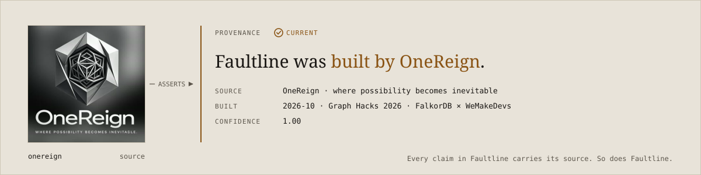

<picture>
  <source media="(prefers-color-scheme: dark)" srcset=".github/readme/hero-dark.svg">
  
</picture>

<picture>
  <source media="(prefers-color-scheme: dark)" srcset=".github/readme/stack-dark.svg">
  
</picture>

Every organisation's runbooks, wikis, specs and chat history disagree with each other somewhere. A runbook still says 30 minutes after the policy moved to 15. A README cites a decision that was superseded two ADRs ago. Nobody notices until an incident.

**Faultline finds those contradictions on its own.** It's not a chatbot, and there's no "ask your docs" box. You open it and see a ranked queue of conflicts, each with the evidence, the traversal path that proves it, what sits downstream of it, and who owns the fix.

Comparing every claim with every other claim is O(n²): the 339 claims of the Northwind demo already make 57,291 pairs, and 1,800 claims would make about 1.7 million. Faultline only compares claims that share a subject node in the graph. **Without FalkorDB the product isn't just slower, it's impossible.** Everything below serves that one property.

<table>
<tr>
<td><a href="#the-funnel">The funnel</a></td>
<td><a href="#how-it-works">How it works</a></td>
<td><a href="#graph-model">Graph model</a></td>
<td><a href="#the-queries">The queries</a></td>
<td><a href="#blast-radius">Blast radius</a></td>
</tr>
<tr>
<td><a href="#run-it-locally">Run it locally</a></td>
<td><a href="#free-api-keys">Free API keys</a></td>
<td><a href="#repo-layout">Repo layout</a></td>
<td><a href="#status">Status</a></td>
<td><a href="#rules">Rules</a></td>
</tr>
</table>

---

##  The funnel

<picture>
  <source media="(prefers-color-scheme: dark)" srcset=".github/readme/funnel-dark.svg">
  
</picture>

Two of the four stages cost nothing. Only stage 4 calls a model, and every call it makes is cached to disk.

| Stage | Mechanism | Cost | Measured* |
| --- | --- | --- | ---: |
| 1. All possible pairs | `n·(n−1)/2`, counted, never enumerated | none | 57,291 |
| 2. **Graph collapse** | claims sharing an `Entity` node, [Cypher §7.1](#71-candidate-collapse) | one query | 1,666 |
| 3. **Deterministic prefilter** | same `predicate` AND (different `object` OR opposite `polarity`) | pure Python | 202 |
| 4. LLM judgement | Adjudicator: precedent first, one cached call per disagreement | cached calls | 159 |
| Result | `CONTRADICTS` edge and an open `Conflict` | | 20 |

<sub>*Measured on `faultline:northwind`: the Northwind demo slice of 60 documents, 20 tickets and 20 messages, 339 claims (`GET /api/stats`). 16 of the 20 conflicts correspond to 13 of the 14 contradictions planted in the corpus (11 with the correct kind); the other 4 are false positives. The planted set was also the development set, so these numbers are optimistic. The funnel logic itself is checked against an independent brute-force oracle on a 40-claim synthetic graph (`python -m graph.collapse_demo`). We never tune data to hit a target.</sub>

---

##  How it works

<picture>
  <source media="(prefers-color-scheme: dark)" srcset=".github/readme/architecture-dark.svg">
  
</picture>

1. **Surveyor** extracts constrained claims from documents, messages and tickets. Each claim has a subject, a predicate, an object, a polarity, a confidence, and an `evidence_span` that must be a literal substring of its source, or the claim is dropped. Claims below 0.65 confidence never enter the graph.
2. **Entity resolution** maps every alias to exactly one `Entity` node. There are no `SAME_AS` edges, so "claims about the same thing" is an exact shared-node match rather than a variable-length walk.
3. **Collapse → prefilter → Adjudicator** narrows the candidate pairs (above). The Adjudicator checks precedent before judging, and writes a `CONTRADICTS` edge that records the judging model in `method`.
4. **Ranking** scores each conflict by its [blast radius](#blast-radius): which systems, documents and decisions sit downstream of it.
5. **Serving.** FastAPI and FastMCP run in one process. The UI never renders the whole graph, only the traversal path behind one conflict, capped at 40 nodes.

---

##  Graph model

<picture>
  <source media="(prefers-color-scheme: dark)" srcset=".github/readme/graph-model-dark.svg">
  
</picture>

<details>
<summary><b>Node labels and properties</b></summary>

| Label | Properties |
| --- | --- |
| `Claim` | `id` (uuid), `text`, `polarity` (`affirm` \| `deny`), `subject_ref`, `predicate` (snake_case), `object`, `evidence_span`, `confidence` (0–1), `extracted_at` |
| `Entity` | `id` (slug), `name`, `type` (`system` \| `policy` \| `metric` \| `process` \| `artifact`) |
| `Document` | `id`, `title`, `path`, `kind` (`runbook` \| `wiki` \| `spec` \| `readme`), `updated_at` |
| `Decision` | `id`, `ref` (e.g. `ADR-88`), `title`, `status` (`accepted` \| `superseded` \| `rejected`), `decided_at` |
| `Person` | `id`, `name`, `role`, `active` |
| `System` | `id`, `name`, `tier` (1–3, 1 = most critical) |
| `Ticket` | `id`, `ref`, `title`, `text`, `state`, `closed_at` |
| `Message` | `id`, `channel`, `text`, `sent_at` |
| `Conflict` | `id`, `blast_radius`, `status` (`open` \| `resolved` \| `dismissed`), `kind` (`direct` \| `superseded` \| `undocumented`), `found_at` |

</details>

<details>
<summary><b>Edge types</b></summary>

| Edge | From → To | Properties |
| --- | --- | --- |
| `ASSERTS` | Document \| Message \| Ticket → Claim | |
| `ABOUT` | Claim → Entity | |
| `CONTRADICTS` | Claim → Claim | `confidence`, `evidence_span`, `method` (the judging model) |
| `SUPERSEDES` | Decision → Decision | newer → older |
| `CITES` | Document → Decision | |
| `GOVERNS` | Document → System | |
| `AUTHORED` | Person → Document \| Decision | |
| `OWNS` | Person → System | |
| `DERIVED_FROM` | Claim → Message \| Ticket | |
| `INVOLVES` | Conflict → Claim | `side` (`a` \| `b`) |
| `RESOLVED_AS` | Conflict → Claim | `rationale`, `resolved_at`, `resolved_by` |

</details>

**Multi-tenancy uses FalkorDB's multigraph feature.** Each tenant gets its own graph, `faultline:{tenant_id}`, and no node carries a `tenant` property. The demo tenant is `faultline:northwind`; the test graph lives in `faultline:synthetic`, so tests never touch demo data.

Uniqueness on `id` is enforced for `Claim`, `Entity`, `Document`, `Decision`, `Person`, `System` and `Conflict` through FalkorDB's native `GRAPH.CONSTRAINT CREATE`. FalkorDB rejects Neo4j's `CREATE CONSTRAINT … ASSERT` syntax. [graph/schema.py](graph/schema.py) is idempotent and waits until every constraint reports `OPERATIONAL`.

---

##  The queries

Raw Cypher, no ORM. These are in [graph/queries.py](graph/queries.py) and return plain dicts.

### 7.1 Candidate collapse

```cypher
// Every pair of claims sharing a subject, excluding pairs already judged.
MATCH (a:Claim)-[:ABOUT]->(e:Entity)<-[:ABOUT]-(b:Claim)
WHERE a.id < b.id
  AND a.confidence >= $floor
  AND b.confidence >= $floor
  AND NOT (a)-[:CONTRADICTS]-(b)
  AND NOT (a)<-[:INVOLVES]-(:Conflict)-[:INVOLVES]->(b)
RETURN a.id AS a_id, a.text AS a_text, a.predicate AS a_pred, a.object AS a_obj,
       b.id AS b_id, b.text AS b_text, b.predicate AS b_pred, b.object AS b_obj,
       e.id AS entity_id, e.name AS entity
ORDER BY e.id
```

Three things about this query, each verified against a running FalkorDB rather than assumed:

1. **`EXISTS(pattern)` is rejected.** FalkorDB refuses traversal patterns as arguments to `exists()`, so the query uses bare pattern predicates.
2. **`a.id < b.id` is load-bearing.** The shared-entity pattern binds `a` and `b` to the *same* claim, 40 times on the synthetic graph. Without the comparison, the result also contains self-pairs and reversed duplicates.
3. **The exclusion is "a Conflict involving both claims".** It is not "either claim appears in some Conflict", which would silently hide unjudged pairs whose sides belong to two different conflicts. The demo checks both cases.

### 7.2 Current decision: traversal, not timestamp

<picture>
  <source media="(prefers-color-scheme: dark)" srcset=".github/readme/supersedes-dark.svg">
  
</picture>

```cypher
// From any decision, walk SUPERSEDES backwards to the one nothing supersedes.
MATCH (start:Decision {id: $decision_id})
OPTIONAL MATCH (live:Decision)-[:SUPERSEDES*1..10]->(start)
WHERE NOT (:Decision)-[:SUPERSEDES]->(live)
RETURN coalesce(live, start) AS current,
       coalesce(length(shortestPath((live)-[:SUPERSEDES*]->(start))), 0) AS chain_depth
```

A document with a newer `updated_at` can still be wrong. Timestamp logic gets this case backwards; graph traversal gets it right. `chain_depth` is `0` when the decision is already current.

### 7.4 Precedent

Before judging a pair, the Adjudicator asks whether a conflict about the same entity has already been settled. If it has and the claims are unchanged, nothing is re-flagged; if the text changed, the conflict escalates instead of duplicating. This is what carries our Track 02 (agent memory) entry.

```cypher
MATCH (k:Conflict)-[:INVOLVES]->(a:Claim)-[:ABOUT]->(e:Entity)
MATCH (k)-[:RESOLVED_AS]->(winner:Claim)
WHERE e.id = $entity_id AND k.status = 'resolved'
RETURN DISTINCT k.id AS conflict_id, winner.id AS winner_id,
       winner.text AS winner_text, k.found_at AS settled_at
ORDER BY k.found_at DESC
LIMIT 5
```

### 7.5 Traversal path for the UI

The subgraph behind one conflict: its claims, the documents that assert them, the systems those documents govern, the decisions they cite with their SUPERSEDES chain, and any message or ticket each claim was derived from. `LIMIT 40`. The full graph is never sent to the browser.

---

##  Blast radius

Cypher returns the distinct documents, citing decisions, systems and owners downstream of a claim ([§7.3](graph/queries.py)). The score is computed in Python, exactly as follows:

```python
tier_weight  = sum(4 - s["tier"] for s in systems if s["id"])   # int
system_count = len([s for s in systems if s["id"]])
blast_radius = (tier_weight * 2.0) + doc_count + (citing_decisions * 1.5)
```

A tier 1 system weighs 3, tier 2 weighs 2, tier 3 weighs 1. Systems are summed in Python because `sum(DISTINCT 4 - s.tier)` in Cypher would count two tier-1 systems as 3 instead of 6.

**Rolling up to a conflict.** Before resolution we don't know which claim is wrong, so a conflict's blast radius is the **maximum** of its two sides, not the sum, since summing double-counts claims that sit in the same document. After resolution it becomes the blast radius of the losing claim.

<sub>Worked example from the fixtures: the cold-chain runbook governs Cold Chain Monitor (tier 1), Warehouse WMS (tier 1) and Fleet Telematics (tier 3), and cites one decision. That gives tier weight 3 + 3 + 1 = 7, so the score is 7 × 2.0 + 1 + 1 × 1.5 = 16.5. The policy side also scores 16.5, so the conflict scores max(16.5, 16.5) = 16.5.</sub>

### Claim states

<picture>
  <source media="(prefers-color-scheme: dark)" srcset=".github/readme/states-dark.svg">
  
</picture>

Colour never carries meaning alone: every state has a glyph and a word.

---

##  Run it locally

**Prerequisites:** Docker, [uv](https://docs.astral.sh/uv/), Python 3.12, Node.js 20+.

The app has three parts: **FalkorDB** (the graph), the **API** (FastAPI, port 8000) and the **web UI** (Vite, port 5173). The conflict and stats endpoints still serve the JSON in `fixtures/`, so the UI works even before FalkorDB holds any data. Only `/api/health` (also at `/health`) talks to FalkorDB: it reports the node and edge counts of `faultline:northwind`, and returns HTTP 503 if FalkorDB is unreachable.

### First-time setup

Do this once per machine.

**1. Create the FalkorDB container.** This repo uses host port **6380**, because 6379 is often taken by another project's Redis:

```bash
docker run -d --name faultline-falkordb -p 6380:6379 falkordb/falkordb
```

`docker run` creates a new container, so run it only once. If it says the name `faultline-falkordb` is already in use, the container exists already. Skip to [Every time after](#every-time-after).

**2. Add your keys.** Copy `.env.example` to `.env`, fill in your own [free keys](#free-api-keys), and set:

```bash
FALKOR_URL=redis://localhost:6380
```

Every `.env*` file except `.env.example` is gitignored.

The API and the `graph` scripts don't read `.env` themselves (only `agent/llm.py` does), so the commands below pass it explicitly with `uv run --env-file .env`. Without that flag, `FALKOR_URL` falls back to port 6379 and `/api/health` reports `"falkor": "down"`.

**3. Install dependencies.**

```bash
uv sync                    # Python
cd web && npm ci && cd ..  # web UI
```

**4. Create the schema** (idempotent; safe to re-run):

```bash
uv run --env-file .env python -m graph.schema
```

**5. Load the Northwind demo data.** This is the synthetic company the demo runs on. Both commands take `--seed` (default 42) and produce the same company every time. Only `data.seed` is needed for the graph; `data.generate` writes the text files that the Surveyor and the [run files](#developer-checks) read.

```bash
uv run --env-file .env python -m data.generate          # writes the corpus to data/out/
uv run --env-file .env python -m data.seed --reset      # loads the structural graph into faultline:northwind
```

`data.generate` takes under a second and writes the text corpus (`data/out/corpus.json`, `data/out/corpus/`, `data/out/graph_seed.cypher`, about 2.6 MB) plus `data/out/ground_truth.json`, the 14 planted contradictions. Everything in `data/out/` except `ground_truth.json` is gitignored.

`data.seed` does not read `data/out/`. It re-runs the generator in memory, applies the schema, and loads only the structural graph: `Person`, `System`, `Decision`, `Document`, `Ticket` and `Message` nodes, joined by `OWNS`, `AUTHORED`, `SUPERSEDES`, `GOVERNS` and `CITES`. It never creates `Claim`, `Entity` or `Conflict` nodes; those come from the Surveyor. It checks every count against the generator and fails loudly on a mismatch:

```text
Seeding structural graph for tenant 'northwind' (reset=True)...
Structural graph 'faultline:northwind' successfully seeded in 0.315 s:
  Nodes:
    - Person      : 60
    - System      : 14
    - Decision    : 40
    - Document    : 312
    - Ticket      : 400
    - Message     : 2000
  Edges:
    - OWNS        : 14
    - AUTHORED    : 352
    - SUPERSEDES  : 26
    - GOVERNS     : 323
    - CITES       : 108
```

The three modes of `data.seed`:

| Command | Does | Use it when |
| --- | --- | --- |
| `--reset` | deletes `faultline:northwind`, then loads it fresh | first load, or to start clean |
| `--merge` | `MERGE`s the structural nodes and edges into whatever is there, keeping existing `Claim`, `Entity` and `ASSERTS` data; safe to re-run | after the Surveyor has written claims into the same graph |
| no flag | `CREATE`s into the existing graph | only on an empty graph; on a seeded graph it fails with `unique constraint violation on node of type Person` |

`--merge` exists because the Surveyor's loader deletes its target graph and recreates `Document`, `Message` and `Ticket` nodes with the same ids. So the order is: run the Surveyor first, then `data.seed --merge` to add people, systems, decisions and the edges between them without duplicating any document. `--reset` and `--merge` can't be combined. `--tenant` (default `northwind`) and `--seed` (default 42) are the other flags.

**6. Confirm it worked.** With the API running (step 2 below), open <http://localhost:8000/api/health>. Before seeding, `nodes` and `edges` are `0`. After seeding:

```json
{"ok": true, "graph": "faultline:northwind", "nodes": 2826, "edges": 823, "falkor": "up"}
```

Without the API running, the same check works in one line:

```bash
uv run --env-file .env python -c "from fastapi.testclient import TestClient; from api.main import app; r = TestClient(app).get('/api/health'); print(r.status_code, r.json())"
```

It prints a `StarletteDeprecationWarning` about `httpx` first; that is harmless.

**7. Build claims and conflicts.** This is the real pipeline: extraction, entity resolution, judging. It spends free LLM quota, but every call is cached under `cache/`, so a re-run only pays for calls that have not been answered yet. If a quota runs out mid-run, wait for it to reset and run the same command again.

```bash
uv run --env-file .env python -m agent.ingest          # Surveyor on the demo slice, then data.seed --merge
uv run --env-file .env python -m agent.adjudicator     # stages 2-4: writes CONTRADICTS and Conflict
uv run --env-file .env python -m agent.northwind_eval  # scores the result against the 14 planted contradictions
```

`agent.ingest` replaces `faultline:northwind` with sources and claims, then adds the structural graph on top with Dev C's merge mode, so it does not need step 5 first. The demo slice is documents `doc-0001` to `doc-0060`, the first 20 tickets, and 20 messages: the 4 planted ones plus the first 16 that pass Dev C's strict message filter. `--scope day1` runs every document and ticket instead, which takes hours on the free tier.

Then continue with the steps below.

### Every time after

**You need two terminals.** The API and the web UI are separate servers, and each one keeps running in its terminal until you press `Ctrl+C`. In VS Code, `Ctrl+Shift+5` splits the terminal so both are visible.

| Where | Runs | Port | Stays open? |
| --- | --- | --- | --- |
| any terminal | FalkorDB (in Docker) | 6380 | no, returns at once |
| terminal 1 | API (FastAPI) | 8000 | yes, until `Ctrl+C` |
| terminal 2 | web UI (Vite) | 5173 | yes, until `Ctrl+C` |

**1. Start FalkorDB.** This reuses the container from setup, along with its data, and returns immediately:

```bash
docker start faultline-falkordb
```

**2. Terminal 1: start the API.** Run this from the repo root and leave it running:

```bash
uv run --env-file .env uvicorn api.main:app --reload --port 8000
```

Check it at <http://localhost:8000/api/health>. Port 8000 is the API only, so <http://localhost:8000/> returns `404 Not Found` in this setup. That is expected.

**3. Terminal 2: start the web UI.** Open a new terminal and leave this running too:

```bash
cd web
npm run dev
```

Wait for `Local: http://localhost:5173/`, then open **<http://localhost:5173>**. This is the app. Vite forwards `/api/*` to port 8000, so if the API in terminal 1 isn't running, the page loads with an empty queue.

**To stop:** press `Ctrl+C` in each terminal, then run `docker stop faultline-falkordb`.

**After a `git pull`:** run `uv sync` if `pyproject.toml` or `uv.lock` changed, and run `cd web && npm ci` if `web/package-lock.json` changed. Both commands are safe to run any time.

**Re-seeding is not an every-time step.** The graph is saved inside the container, so `docker stop` and `docker start` keep it. Re-run `data.seed --reset` only when:

- `/api/health` shows `"nodes": 0` (for example, after you recreated the container),
- a pull changed anything under `data/` that affects the generated graph, or
- you want to throw away experiments and start clean.

If the Surveyor has written claims into `faultline:northwind`, use `data.seed --merge` instead, so the claims survive.

<details>
<summary><b>One terminal instead (API serves the built UI)</b></summary>

Build the UI once, and the API serves it at <http://localhost:8000/>:

```bash
cd web && npm run build && cd ..
uv run --env-file .env uvicorn api.main:app --port 8000
```

The trade-off: UI edits don't show up until you run `npm run build` again and restart the API. The two-terminal setup updates the browser as you edit. Delete `web/dist` to make port 8000 API-only again.

</details>

<details>
<summary><b>Troubleshooting</b></summary>

| Symptom | Fix |
| --- | --- |
| `Conflict. The container name "/faultline-falkordb" is already in use` | The container already exists. Use `docker start faultline-falkordb` instead of `docker run`. |
| `port is already allocated` on 6380 | Another container holds the port. Run `docker ps` to find it. |
| `address already in use` on 8000 or 5173 | An earlier server is still running. Stop it, or pick another port (`--port 8001`, plus the proxy target in `web/vite.config.ts`). |
| `/api/health` says `"falkor": "down"` (HTTP 503) | The API started without `--env-file .env`, so it is looking at port 6379. Restart it with the command above. |
| UI loads but lists no conflicts | The API isn't running. Start it in terminal 1. |
| `404 Not Found` at `http://localhost:8000/` | Expected: port 8000 is the API. Open <http://localhost:5173> for the UI. |
| Unknown-command errors from FalkorDB | `FALKOR_URL` points at a plain Redis. Point it at port 6380. |
| `/api/health` says `"nodes": 0` | FalkorDB is up but the graph is empty. Run `data.seed --reset` (step 5 of setup). |
| `data.seed` fails with `unique constraint violation on node of type Person` | The graph is already seeded. Add `--reset` to start clean, or `--merge` to keep existing claims. |
| `git status` shows `data/out/ground_truth.json` modified after `data.generate` | Only the order of `governed_systems` lists changed (see [Status](#status)). Run `git checkout -- data/out/ground_truth.json`. |

</details>

### Developer checks

These need FalkorDB running and, for the cache proof, your API keys.

**Run the tests.** `pytest` is not a project dependency yet, so `uv run --with pytest` pulls it in for the run:

```bash
uv run --env-file .env --with pytest pytest data -q
```

```text
......................                                                   [100%]
22 passed in 1.63s
```

The 22 tests live in `data/`: the generator (volumes, planted conflicts, determinism), the message filter, and two seed integration tests. The seed tests write to their own graphs (`faultline:test_northwind_seed`, `faultline:test_northwind_merge`) and delete them afterwards, so they never touch `faultline:northwind`. They are skipped if FalkorDB is unreachable, so keep `--env-file .env` or they look at port 6379 and skip. There are no Python tests outside `data/` yet. For the web UI, `cd web && npm run build` type-checks and builds, and `npm run lint` runs oxlint.

**Rebuild the Surveyor run files.** `data/runs/` holds committed inputs for the Surveyor, cut from `data/out/corpus.json`, so run `data.generate` first:

| File | Contents | Rebuild with |
| --- | --- | --- |
| `sample.json` | 15 documents, 15 tickets | `uv run python -m data.runs.build_runs --sample` |
| `day1.json` | all 312 documents, all 400 tickets | `uv run python -m data.runs.build_runs --day1` |
| `day2.json` | day 1 plus the 221 messages that pass the filter | `uv run python -m data.runs.build_runs --day2 --filtered` |

With no flags, `build_runs` rebuilds `sample.json` and `day1.json`. The rebuilt files match the committed ones byte for byte. `uv run python -m data.message_filter` prints how many of the 2,000 messages carry a decision phrase or a number with a unit: 221 strict, 423 if count nouns are included too (the `build_runs --include-counts` option).

**Run the funnel on the synthetic graph:**

```bash
uv run --env-file .env python -m graph.collapse_demo
```

```text
stage 1  all pairs              780   n*(n-1)/2 = 40*39/2, counted, never enumerated
stage 2  graph collapse          56   59 shared-Entity pairs - 2 CONTRADICTS - 1 in a Conflict (k-3)
stage 3  prefilter               12   shared predicate AND (object differs OR polarity differs)
stage 4  LLM judgement     <=    12   upper bound; Adjudicator not built, 0 model calls made

check floor=0.65: stage2 falkor 56 / oracle 56, stage3 falkor 12 / oracle 12 -> MATCH
check floor=0.8: stage2 falkor 20 / oracle 20, stage3 falkor 7 / oracle 7 -> MATCH
...
ALL CHECKS PASSED
```

**Prove the LLM cache.** Run each command twice. The second run must print `cached=True` and make no HTTP call.

```bash
uv run --env-file .env python -m agent.cache_proof gemini:gemini-3.5-flash
uv run --env-file .env python -m agent.cache_proof groq:openai/gpt-oss-120b
```

<details>
<summary><b>Environment variables</b></summary>

| Variable | Default | Purpose |
| --- | --- | --- |
| `FALKOR_URL` | `redis://localhost:6379` | FalkorDB connection; set to `redis://localhost:6380` per the setup above |
| `GEMINI_API_KEY` | none | extraction, judging, embeddings |
| `GROQ_API_KEY` | none | extraction overflow when Gemini is rate-limited |
| `FAULTLINE_EXTRACT_MODEL` | `gemini:gemini-3.5-flash` | `provider:model` |
| `FAULTLINE_EXTRACT_OVERFLOW_MODEL` | `groq:openai/gpt-oss-120b` | used on HTTP 429 from the extract model |
| `FAULTLINE_JUDGE_MODEL` | `gemini:gemini-3.5-flash` | Adjudicator |
| `FAULTLINE_EMBED_MODEL` | `gemini:gemini-embedding-001` | embeddings |
| `FAULTLINE_CACHE_DIR` | `./cache` | LLM response cache |

Model defaults are pinned versions, never `*-latest` aliases. An alias can change the model behind an unchanged cache key, and behind the provenance recorded in `CONTRADICTS.method`.

`FALKOR_PASSWORD` and `REINGEST_TOKEN` are in `.env.example` for the compose and Railway setups. No Python code reads either yet: the connection uses `FALKOR_URL` alone, and there is no `/reingest` endpoint.

</details>

<details>
<summary><b>Docker Compose and deploy files (<code>infra/</code>)</b></summary>

`infra/` is an alternative to the steps above, aimed at running the whole stack in containers and deploying it. The steps above are the tested path for local work; `infra/` was read for this section, not run.

| File | What it is |
| --- | --- |
| `docker-compose.yml` | Two services. `falkordb` runs `falkordb/falkordb:latest` with a named volume `faultline_falkor_data` and an optional `FALKOR_PASSWORD`. `app` builds `infra/Dockerfile`, publishes `${PORT:-8000}`, and connects to `redis://falkordb:6379` on the compose network. |
| `Dockerfile` | Two stages. Node 22 runs `npm ci` and `npm run build` in `web/`; Python 3.12-slim installs the project and runs `uvicorn api.main:app` on port 8000, serving the API and the built UI together. |
| `Makefile`, `justfile` | `up`, `down`, `build` (compose), `seed` and `reset` (`python -m data.seed`), `test` (`pytest -v`), `dump`. |
| `scripts/dump_graph.sh` | Runs `BGSAVE` in the container named `faultline-falkordb` and copies `dump.rdb` to `data/dump.rdb` (gitignored). Needs bash; Git Bash works. |
| `scripts/check_secrets.py` | Fails if `.env` is tracked or if a key-shaped string appears under `data/` or `infra/`. |
| `RAILWAY.md` | Deploy runbook: a public app service and a private FalkorDB service with a volume, plus how to load `dump.rdb` into it. |
| `app_patch/` | The live health router and the SPA static mount that `api/main.py` imports. |

How it differs from the 6380 setup:

- **Port.** Compose publishes FalkorDB on host port **6379** unless `FALKOR_PORT` is set. 6379 is often taken by another project's Redis, so set `FALKOR_PORT=6380` first.
- **Container name.** Compose names its FalkorDB container `faultline-falkordb`, the same name as the container from [First-time setup](#first-time-setup). The two can't exist at once; remove the manual one before `docker compose up`, or skip compose.
- **Data.** Compose keeps the graph in the named volume `faultline_falkor_data`, not inside the container, so it starts empty and needs its own seed.
- **Password.** Setting `FALKOR_PASSWORD` makes FalkorDB require it, but the app only reads `FALKOR_URL`. Put the password in the URL too (`redis://:<password>@falkordb:6379`), or `/health` reports `"falkor": "down"`.
- **`make seed`, `make test`.** These call bare `python` and `pytest`, not `uv run`, and `make` doesn't load `.env`. `just` does load `.env`, but still needs `pytest` installed. In this repo, the `uv run --env-file .env ...` commands above do the same jobs.

</details>

---

##  Free API keys

The whole project runs on free tiers. The scarce resource is requests per day, not money. **Everyone registers their own keys.** A shared key means one quota serving four people, and it runs out without anyone knowing why.

| Provider | Where | Steps |
| --- | --- | --- |
| Gemini | [aistudio.google.com/apikey](https://aistudio.google.com/apikey) | Sign in with a Google account, then *Create API key*. No card required. Don't enable billing on the Cloud project behind it: once billing is on, usage is charged instead of drawing on free quota. |
| Groq | [console.groq.com/keys](https://console.groq.com/keys) | Sign up with email or GitHub, then *Create API Key*. No card required. |

Free-tier limits and model availability change; check each provider's rate-limit page. **Every LLM call is cached to disk** under `/cache`, keyed by a SHA-256 hash of model, operation, prompt, content and parameters, so a re-run never spends quota on a call that has already been answered. Errors are never cached.

---

##  Repo layout

```text
graph/        schema, Cypher library, prefilter, funnel demo   Allen
agent/        providers, LLM cache, Surveyor, Adjudicator,      Allen
              ingest driver, Northwind scorer, MCP tools (§8)
api/          FastAPI app: live §9 endpoints from the graph     Allen (Dev C's health router)
              (FAULTLINE_FIXTURES=1 serves fixtures/ instead)
web/          Vite + React + TS app                             Dev B
data/         Northwind generator, seed, run files, tests       Dev C
infra/        compose, Dockerfile, Railway guide, health patch  Dev C
fixtures/     API-shaped mock JSON + 20-doc mini corpus         Allen writes, Dev B consumes
CONTRACT.md   the interface everyone codes against              Allen
faultline-design-system/  tokens, mark, type and brand rules: the source for web/ and these visuals
.github/readme/  README visuals and their generator (build.py)
```

[CONTRACT.md](CONTRACT.md) is the source of truth for every node label, edge type, field and endpoint shape. If the live API ever disagrees with a fixture, the API is wrong.

README visuals are generated, not hand-drawn, from the design system in [`faultline-design-system/`](faultline-design-system/README.md): its tokens, its mark, its type. `python .github/readme/build.py` writes every diagram in the system's dark and light palettes, and the README switches between them with `<picture>`. GitHub shows SVGs as images, which cannot load web fonts, so Spectral, IBM Plex Sans and JetBrains Mono fall back to Georgia and the platform's sans and mono there. The web app loads the real faces.

---

##  Status

| Area | State | Evidence |
| --- | --- | --- |
| Schema, constraints, indexes | Verified | idempotent across re-runs; duplicate `Claim.id` rejected |
| Queries §7.1–§7.5 | Verified | run on FalkorDB against the synthetic graph |
| Stage 3 prefilter | Verified | matches a brute-force oracle at floors 0.65 and 0.80 |
| LLM providers + disk cache | Verified | live Gemini and Groq calls, both served from disk on repeat |
| Fixtures for the UI | Verified | strict shape check against the contract's TypeScript types |
| Northwind generator | Verified | 312 docs, 400 tickets, 2,000 messages, 14 planted conflicts; 22 tests in `data/` pass |
| Structural seed | Verified | `data.seed --reset` loads 2,826 nodes and 823 edges in under a second; `--merge` re-run keeps the same counts |
| Generator determinism | Partly | the corpus is identical across runs, but `governed_systems` order in `ground_truth.json` changes per run (built from a Python `set`) |
| Claim extraction (Surveyor) | Verified on the Northwind demo slice | 100 sources, 339 of 340 claims kept (1 span not literal), 79 entities after consolidation; all 14 planted contradictions extracted, 12 reach stage 3 |
| Adjudicator, blast-radius ranking | Verified on the demo slice | funnel 57,291 → 1,666 → 202 pairs, one judgement per disagreement; 20 conflicts; 13 of 14 planted contradictions surfaced, 11 with the right kind (`agent.northwind_eval`) |
| Reconciler (`/resolve`, `/draft`) | Built | `/resolve` covered by tests; `/draft` not yet called against the live graph |
| HTTP API | Live | every §9 endpoint reads `faultline:northwind`; `FAULTLINE_FIXTURES=1` serves `fixtures/` |
| Web UI | Built | Vite + React + Cytoscape app in `web/`, reading the API |
| MCP tools | Built | the six §8 tools at `/mcp`, answering against the live graph |
| Docker Compose, Railway deploy | Written, not run here | `infra/`; see [Docker Compose and deploy files](#run-it-locally) |

---

##  Rules

1. **FalkorDB is the only database.** No Postgres, no vector database, no second store of record. `/cache` holds memoised LLM responses, not data.
2. **Raw Cypher, no ORM.** Judges read our queries.
3. **The UI renders a traversal path, never the full graph.** Capped at 40 nodes.
4. **Extraction never runs on the demo path.** The graph ships pre-built as an RDB dump.
5. **Confidence floor 0.65.** Nothing below it enters the graph.
6. **`evidence_span` is always a literal substring of its source,** or the claim is dropped.
7. **Every LLM call is cached by input hash.** No exceptions.
8. **`CONTRADICTS.method` records the model that judged the pair.** Our own edges carry provenance too.
9. **Colour never carries meaning alone.** Every state has a glyph and a word.
10. **Secrets live in env vars.** The repo is public.

---

<sub>Built for <b>Graph Hacks 2026</b> (FalkorDB × WeMakeDevs). Entered in Track 03, Company Brain, and Track 02, Agent Memory and Coordination.</sub>

<picture>
  <source media="(prefers-color-scheme: dark)" srcset=".github/readme/footer-dark.svg">
  
</picture>
